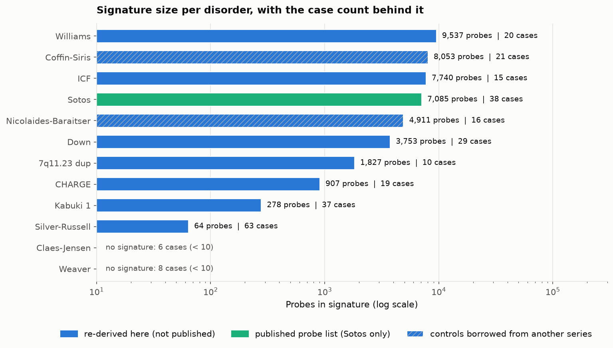
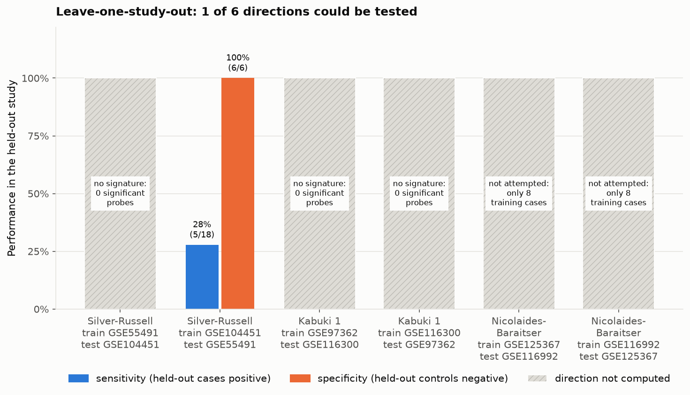
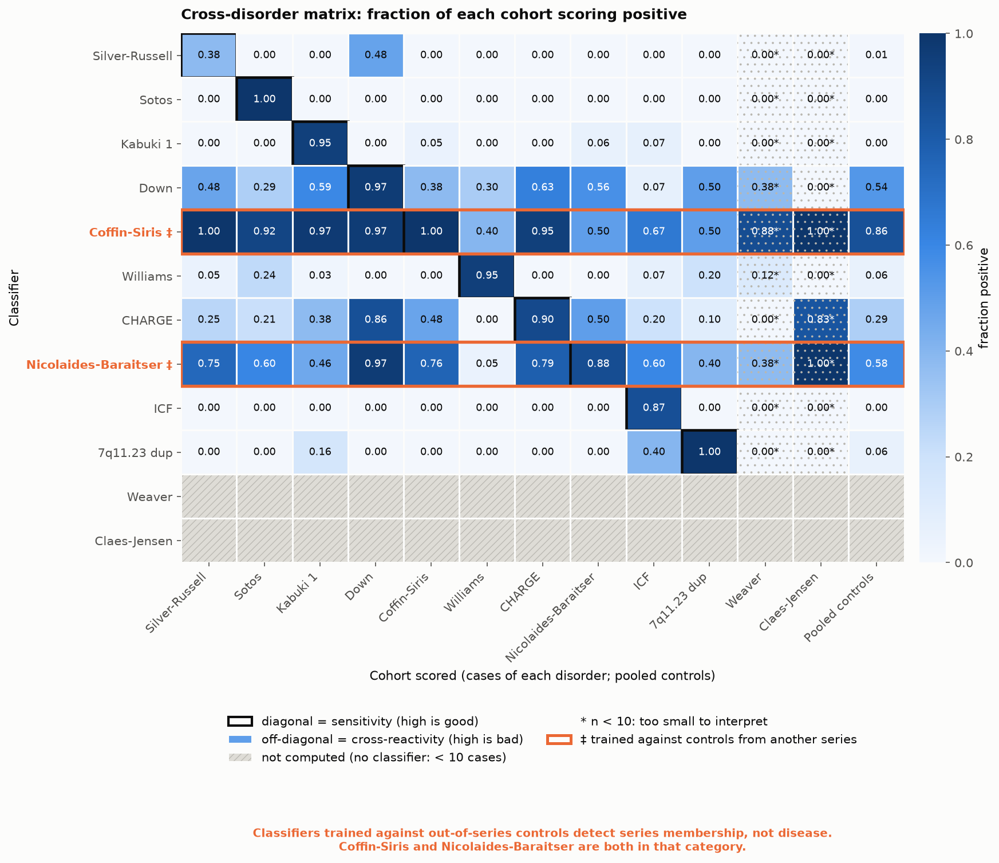
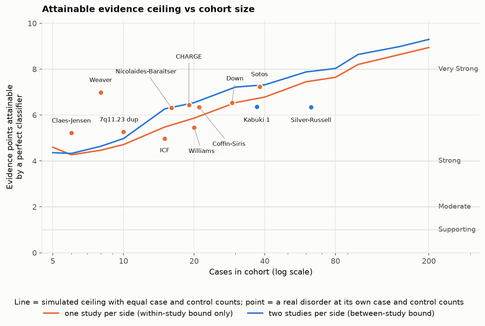

# EpiGrade: An Open, Reproducible Benchmark for DNA Methylation Episignature Classifiers

**Upasana Bhaumik (23BCB0074), Samhitaa Saravanakumar (23BCB0125), Divyanjali Tyagi (23BCB0123)**

Vellore Institute of Technology (VIT), Vellore, India

---

## Abstract

DNA methylation episignatures are used in clinical laboratories to interpret genetic variants of uncertain significance, yet the evidence that they work rests largely on one private reference database that outside laboratories cannot inspect. We built EpiGrade, a benchmark that rebuilds what can be rebuilt from public data alone. From 18 Gene Expression Omnibus accessions we harvested 3,732 samples, retained 1,622, and recorded a reason for each of the 2,110 excluded. The corpus covers 12 disorders; 10 have enough cases for a signature. The published Sotos syndrome classifier was reproduced exactly on all four checks. For the other nine disorders we re-derived signatures under one fixed threshold and audited them. Three findings follow. First, only three disorders have cases in two independent studies, and a signature could be transferred across studies in just 1 of 6 directions, where it detected 5 of 18 held-out cases. Second, a complete 12 by 13 cross-disorder matrix shows that classifiers derived against borrowed controls behave as batch detectors: one scores 85.8% of pooled controls positive. Third, 500 random probes separate Sotos cases from controls at an area under the curve of 1.00, so within-study separation cannot by itself identify a signature. We therefore built an identification engine that accepts a user's probe list, searches all 12 cohorts, and calls a match only when the probes outperform random probe sets of equal size. The calibration method is not new; the contribution is that every number can be regenerated by one command from public accessions.

**Keywords:** episignature, DNA methylation, reproducibility, calibration, variant of uncertain significance, batch confounding

---

## 1. Introduction

### 1.1 What an episignature is and why it matters

Sequencing a child with a suspected genetic disorder often returns a variant that nobody can interpret. The gene is plausible, the variant is rare, but there is not enough evidence to call it disease-causing or harmless. Under the standards of the American College of Medical Genetics and Genomics and the Association for Molecular Pathology (ACMG/AMP), such a result is a variant of uncertain significance [1]. It cannot be used to confirm a diagnosis, guide treatment, or test relatives.

Many of the genes involved in neurodevelopmental disorders encode proteins that write, read, or erase chemical marks on DNA and its packaging. When one of these genes is disrupted, the pattern of DNA methylation in blood changes in a characteristic way at hundreds or thousands of positions (CpG sites). That characteristic pattern is called an episignature [2]. It offers a second, independent test. If a patient with an uninterpretable variant in the gene *NSD1* shows the *NSD1* methylation pattern, the variant is probably pathogenic. If the pattern is absent, the variant is probably benign.

The approach has scaled quickly. Aref-Eshghi and colleagues mapped episignatures in 42 genetic syndromes and identified 34 robust disease-specific ones [3]. A clinical testing network reported 2,399 cases, with positive findings in 18.7% of comprehensive screens and 32.4% of targeted analyses [4].

### 1.2 How results are currently reported

A clinical episignature report does not state how many times more likely the observed pattern is under one hypothesis than the other. The dominant commercial assay compares each patient's profile with a proprietary reference, the EpiSign Knowledge Database, using clustering and a support vector machine, and reports the result according to recommendations agreed by an expert working group [4]. Those categories are qualitative. They are not a calibrated measure of evidence strength.

This matters because the ACMG/AMP framework is quantitative underneath. Tavtigian and colleagues showed that its evidence levels (supporting, moderate, strong, very strong) correspond to specific odds of pathogenicity [10]. Brnich and colleagues set out how a functional assay should be validated against known pathogenic and benign controls before it is assigned a strength [9]. Pejaver and colleagues then calibrated computational predictors by estimating, at each score, how strongly that score supports pathogenicity [8]. Episignature scores have not been put through the same process in public.

### 1.3 The reproducibility problem

The validation of most clinical episignatures cannot be checked from outside. The reference database is private. Published signatures are often reported as lists of CpG sites without the trained classifier or the full training cohort. The public data that do exist are scattered across the Gene Expression Omnibus (GEO), each deposit labelled in its own vocabulary.

Independent checks are rare and sobering. Husson and colleagues generated new data for ten published signatures and found that sensitivities "unexpectedly spanned a very large spectrum": four reached 100%, while two fell below 40% [7]. That study is the closest prior work to ours, and it required new laboratory data from a hospital network. We ask a narrower question: how much can be established from what is already public?

### 1.4 Contributions

1. **A public corpus with a recorded reason for every exclusion.** 18 accessions, 3,732 samples, 12 disorders, with each sample assigned a role by explicit rules.
2. **An exact reproduction of a published classifier.** The Sotos syndrome signature of Choufani and colleagues [5], reproduced on four checks.
3. **Nine re-derived signatures under one fixed threshold**, each labelled as re-derived and never presented as a reproduction of a published signature.
4. **A structural audit**: a confounding gate, leave-one-study-out in both directions for every disorder with two studies, and a complete cross-disorder matrix.
5. **Calibrated evidence bands with an attainable ceiling**, separating between-study bounds from within-study ones.
6. **An identification engine** that evaluates a user-supplied signature against all 12 cohorts, with a match rule that we changed after the originally specified rule failed on real data.
7. **One-command reproduction** of every table and figure.

We do not claim the calibration method is new. It is Pejaver-style calibration [8] applied to a data type that had not been calibrated in public, and a general implementation is available on CRAN [11]. We do not claim cross-disorder specificity testing is new; it is routine inside the private database [3]. The claim is that this version can be checked.

---

## 2. Literature Review

### 2.1 Founding signatures

**Choufani et al. (2015)** described a genome-wide methylation signature for *NSD1* loss of function, the cause of Sotos syndrome [5]. They published the list of 7,085 signature CpG sites, the scoring rule, and the data (GEO accession GSE74432). The scoring rule is simple: correlate a sample with the median profile of cases, correlate it with the median profile of controls, and take the difference. The paper also reported that samples with Weaver syndrome, a clinically similar overgrowth disorder caused by a different gene, did not carry the signature, and that *NSD1* missense variants of uncertain significance split into signature-positive and signature-negative groups. Because list, rule and data are all public, this is our reproduction target.

**Butcher et al. (2017)** derived signatures for CHARGE syndrome (*CHD7*) and Kabuki syndrome (*KMT2D*), two conditions with overlapping clinical features [6]. Their data (GSE97362) include separate discovery and validation cohorts and variants of uncertain significance, which makes cohort assignment a real task: counting validation samples as confirmed cases would inflate the cohort.

### 2.2 Scaling up and clinical reporting

**Aref-Eshghi et al. (2020)** extended the approach to 42 syndromes and 34 robust signatures and showed that classifying one signature at a time can misclassify closely related disorders, which is why they argued for multiclass models [3]. This is the specificity question our cross-disorder matrix asks, answered there inside a private reference.

**Kerkhof et al. (2024)** reported the clinical experience of the EpiSign network and published reporting recommendations [4]. The assay compares each profile with the EpiSign Knowledge Database. The diagnostic yield is substantial. The reference set is not public.

**Aref-Eshghi et al. (2019)** had earlier shown the diagnostic value of genome-wide methylation testing in genetically unsolved individuals [12], and **Sadikovic et al. (2020)** reviewed episignatures as a tool for functional annotation of variants [2].

### 2.3 Independent evaluation

**Husson et al. (2024)** is the closest prior work [7]. They generated methylation data from 101 carriers of pathogenic or likely pathogenic variants in ten genes, 57 carriers of variants of uncertain significance and 25 controls, and tested ten published signatures with a nearest-neighbour classifier in a leave-one-out design. Specificity was 100%. Sensitivity ranged from 100% for *ATRX*, *DNMT3A*, *KMT2D* and *NSD1* to below 40% for *CREBBP* and one *CHD8* signature. They concluded that "episignatures do not perform equally well" and called for larger validation sets. Our work differs in using only data that are already public, in asking about cross-study transfer rather than new-sample sensitivity, and in converting scores to calibrated evidence.

### 2.4 Calibration of evidence

**Tavtigian et al. (2018)** recast the ACMG/AMP rules as a Bayesian framework in which each evidence level multiplies the odds of pathogenicity by a fixed factor [10]. We use their scaling, with an odds base of 2.08 per evidence point.

**Brnich et al. (2019)** gave recommendations for applying the functional evidence criteria PS3 and BS3, including how the number of validation controls limits the strength a functional assay can claim [9]. That idea, that cohort size caps attainable evidence, is the basis of our ceiling analysis.

**Pejaver et al. (2022)** calibrated thirteen computational predictors by estimating a local likelihood of pathogenicity at each score and reading off the score intervals that justify each evidence level [8]. This is the template we follow.

**Badonyi and Marsh (2025)** released `acmgscaler`, an R package that converts functional or computational scores to ACMG/AMP evidence strengths with parameters set adaptively from the data [11]. A general tool therefore exists. Ours is an application to episignature scores with one addition specific to this setting: resampling at the level of the study.

### 2.5 Tools

**EpiSign** is the clinical assay described above [4]. **EpigenCentral** is a web portal for methylation data analysis and classification in rare diseases [13]. **NSBEpi** detects episignatures from nanopore sequencing with support vector machines [14]. **MethaDory** offers openly available classifiers trained on synthetic cases, distributed as a local application (preprint) [15]. None of these reports calibrated likelihood ratios with a between-study confidence bound, and none lets a user test an arbitrary signature against a reference corpus with a random-probe control.

### 2.6 Language models for metadata curation

Assigning roles to GEO samples requires reading free-text metadata. Rogic and colleagues evaluated large language models on this task and found that GPT-4o correctly annotated 77% of mouse-strain and 59% of cell-line experiments [16]. Our use of a language model to resolve ambiguous labels is an application of this line of work, not a contribution to it.

---

## 3. Methodology

### 3.1 Corpus assembly and triage

We harvested sample metadata for 18 GEO accessions: 11 that contain cases of a named disorder, 6 population-control collections with no cases, and 1 collection whose public metadata carries no diagnosis. Only processed beta values were used. No raw array files were downloaded.

Every sample was assigned one role: case, matched control, population control, unaffected relative, under test (a variant of uncertain significance or a validation sample), non-target disease control, wrong tissue, or unresolvable. Roles were assigned by rules over a controlled vocabulary. A sample was retained only as a confirmed case or a control. Everything else was excluded with the reason recorded.

### 3.2 Harmonisation with a confidence router

Each rule produces a role and a confidence. High-confidence assignments are accepted. Low-confidence ones are escalated to a language model with the raw metadata and the vocabulary, and anything still ambiguous is left unresolved. We did not guess.

To check the rule engine we wrote a second, independent implementation of the same judgment and compared the two on 100 samples. Both implementations were written with AI assistance. The comparison is therefore an AI-versus-AI consistency check, not human curation. A template for human curation was generated but had not been filled in when this paper was written.

### 3.3 Probe filtering

Probes on the Chen et al. cross-reactive list were removed [17]. For the Sotos series the deposited matrix already contained exactly the 424,586 probes the original paper reports and none of the cross-reactive probes, so the filter changed nothing there. No sex-chromosome or polymorphism filter was applied to the re-derived signatures.

### 3.4 The Choufani rule, reproduced exactly

For the published list of signature probes, let $m_c$ be the median beta value across discovery cases at each probe and $m_n$ the median across discovery controls. The score of sample $x$ is

$$S(x) = r(x, m_c) - r(x, m_n)$$

where $r$ is the Pearson correlation over the signature probes. A positive score classifies the sample as case-like.

Median profiles were built from the discovery cohort only. Each discovery sample was scored against profiles rebuilt without it (leave-one-out). Replication cases, Weaver samples and missense variants were never used to build profiles.

### 3.5 Re-derivation (Path B) and its threshold

No probe list is available to us for the other nine disorders. For each we tested every probe for a difference between cases and controls with a two-sided Mann-Whitney U test, corrected for multiple testing, and kept probes that were significant and whose mean beta difference exceeded an effect-size floor. The classifier is then the same correlation rule. Every such signature is labelled `rederived_not_published` in every output row.

**The threshold was changed once.** We first applied the original paper's thresholds to every disorder: Bonferroni correction at 0.05 with a 20% effect floor. They found nothing usable for Silver-Russell, Kabuki or CHARGE syndrome. Bonferroni correction across more than 400,000 correlated probes with a 20% floor is tuned to the unusually large Sotos effect. We replaced it with the Benjamini-Hochberg false discovery rate [18] at 0.05 and a 10% floor, a standard choice for genome-wide methylation testing. That default was set before any disorder was retried and has not been changed since. Sotos keeps the published list. A test in the repository fails if any re-derived row carries another threshold.

A disorder needs at least 10 confirmed cases before a signature is attempted, and a signature needs at least 10 probes. Neither minimum was lowered at any point.

**Controls.** Where a study includes matched controls, those are used. Two studies do not. GSE116992 (Coffin-Siris syndrome and half of the Nicolaides-Baraitser cases [20]) deposited no controls, so we used the 27 controls of GSE125367, which was deposited by a different laboratory. GSE52588 (Down syndrome [19]) has no unrelated controls, so the 29 unaffected siblings serve as the comparison group for that disorder only. Both choices are recorded on every affected row, and their consequences are reported in Section 5.

**Leakage.** A training sample is scored against median profiles rebuilt without it. The choice of probes still used every training sample, so self-scores remain optimistic. A unit test disables the guard on purpose and confirms that apparent separation increases.

### 3.6 The confounding gate

If every case of a disorder comes from one study, disease status and study of origin are perfectly confounded. Clean separation in that study cannot be told apart from a batch effect. The gate labels each disorder as failing (one study), structurally passing (two or more studies), or not testable (fewer than 10 cases).

### 3.7 Leave-one-study-out

For each disorder with cases in two studies we derive a signature from one study and score the other, in both directions. Sensitivity is the fraction of held-out cases scoring positive. Specificity is the fraction of held-out controls scoring negative. A control used in training never counts toward specificity. A direction that cannot be built is recorded with its reason.

### 3.8 Cross-disorder matrix

Every built classifier scores the cases of all 12 disorders and a pooled control corpus of 273 matched controls drawn from the disease series, with the classifier's own training controls excluded. Cells with fewer than 10 samples are marked too small to interpret.

### 3.9 Calibration and the study-level bootstrap

For a query score we estimate a local likelihood ratio: the density of case scores near the query divided by the density of control scores, each with its own adaptive window. The ratio is converted to evidence points with base 2.08 [10] and to a band: supporting (1 point), moderate (2), strong (4), very strong (8).

The band is assigned from the confidence bound closer to a ratio of 1, never from the point estimate. If the interval spans 1, the band is "no evidence".

Samples within a study are not independent, so the bootstrap resamples whole studies. **With one study on either side this procedure is degenerate**: every resample is identical to the original data and the interval has zero width. That is not precision. In that case we report no between-study bound. We compute a sample-level bootstrap instead and label the resulting band `within_study_only`.

### 3.10 The attainable ceiling

We simulate a perfect classifier, with fully separated scores, at each disorder's real numbers of cases, controls and studies, and pass it through the same pipeline. The resulting band is the strongest evidence any classifier could earn there. It describes the cohort, not the classifier.

### 3.11 The identification pipeline

A user submits a probe list with optional direction and weight columns. The engine:

1. validates identifiers, removes duplicates, and reports coverage on the 450K, EPIC v1 and EPIC v2 arrays and in each corpus matrix;
2. refuses if fewer than 10 probes are usable, and warns if more than half are missing;
3. scores all 12 cohorts and reports the area under the curve (AUC) of cases against that cohort's controls;
4. compares the mean absolute case-control difference at the submitted probes with 1,000 random probe sets of the same size from the same cohort;
5. calls a match only if AUC is at least 0.70 **and** the submitted probes exceed every random set, ranking cohorts by their excess over the random-probe distribution;
6. for a match, reports the signature's own row of the cross-disorder matrix, the cohort's evidence ceiling, overlap with the ten corpus signatures, and an attribution panel including agreement between submitted and observed directions.

Step 4 was not in the original design. Section 5.6 explains why it was added.

---

## 4. Analysis

### 4.1 Samples

Of 3,732 harvested samples, 1,622 were retained and 2,110 excluded (Table 1). The largest exclusion category, unresolvable labels, is dominated by one accession whose public metadata identifies samples only as numbered probands.

**Table 1. Sample triage.**

| Category | Samples |
|---|---|
| Harvested | 3,732 |
| Retained for analysis | 1,622 |
| Excluded: unresolvable labels | 1,239 |
| Excluded: non-target disease controls | 558 |
| Excluded: unaffected relatives | 198 |
| Excluded: samples under test | 108 |
| Excluded: wrong tissue | 7 |
| Excluded, total | 2,110 |

### 4.2 Disorders and the gate

The corpus contains 12 disorders (Table 2). The gate fails 7, passes 3 structurally, and finds 2 not testable.

**Table 2. Twelve disorders, four verdicts.**

| Disorder | Cases | Studies | Verdict | Signature probes |
|---|---|---|---|---|
| Silver-Russell syndrome | 63 | 2 | graded | 64 |
| Kabuki syndrome type 1 | 37 | 2 | graded | 278 |
| Nicolaides-Baraitser syndrome | 16 | 2 | graded | 4,911 |
| Sotos syndrome | 38 | 1 | single-study | 7,085 (published) |
| Down syndrome | 29 | 1 | single-study | 3,753 |
| Coffin-Siris syndrome | 21 | 1 | single-study | 8,053 |
| Williams syndrome | 20 | 1 | single-study | 9,537 |
| CHARGE syndrome | 19 | 1 | single-study | 907 |
| ICF syndrome | 15 | 1 | single-study | 7,740 |
| 7q11.23 duplication syndrome | 10 | 1 | single-study | 1,827 |
| Weaver syndrome | 8 | 1 | too few cases | none |
| Claes-Jensen syndrome | 6 | 1 | too few cases | none |

"Graded" means only that a cross-study test is structurally possible. Section 5.2 shows how seldom it could actually be run.

### 4.3 Signatures

All 10 eligible disorders produced a signature under the single default threshold, so no further change was considered. We recorded 19 derivations in total: 12 canonical rows (10 built, 2 not attempted for lack of cases), 6 leave-one-study-out directions, and 1 rejected alternative.

Signature size does not track cohort size (Figure 1). The number of probes passing the significance test alone is more telling. For Silver-Russell syndrome 324 probes were significant, for Down syndrome 37,618 and for Williams syndrome 82,427. For Coffin-Siris syndrome, derived against controls from another series, 259,707 were, which is more than half of all probes tested. A disorder does not alter half the methylome. A difference between two laboratories' batches can.

### 4.4 The ceiling computation

At every one of the 12 real cohort shapes the perfect-classifier ceiling is "Strong". In the simulated curve "Very Strong" first becomes attainable at 80 cases with two studies on each side and at 100 cases with one. A between-study bound is possible for only 2 disorders, because Nicolaides-Baraitser syndrome, although its cases span two studies, draws all its controls from one.

---

## 5. Result

Every number in this section is read from a file in `results/tables/`. Supplementary Table S1 maps each one to its source file and row.

### 5.1 Sotos reproduction

All 4 of 4 checks pass (Table 3).

**Table 3. Reproduction of Choufani et al. [5].**

| Check | Published | Observed |
|---|---|---|
| Discovery separation | 19 cases and 53 controls split at score 0 | case>0: 19/19; control<0: 53/53; case scores [0.027, 0.158], control scores [-0.157, -0.098] |
| Weaver syndrome negative | all 8 negative | 8/8 scored negative |
| Missense variants | 9 positive, 7 negative | n=16, positive=9, negative=7 |
| Replication cohort | held-out cases positive | n=19, positive=19 |

The discovery scores are leave-one-out. The replication cases were never used to build the profiles.

### 5.2 Leave-one-study-out

Of 6 directions across the three graded disorders, 1 could be computed (Table 4, Figure 2).

**Table 4. Leave-one-study-out, both directions.**

| Disorder | Train | Test | Outcome |
|---|---|---|---|
| Silver-Russell | GSE104451 | GSE55491 | 64 probes; sensitivity 5/18 (27.8%); specificity 6/6 |
| Silver-Russell | GSE55491 | GSE104451 | not computed: 0 significant probes with 18 cases and 6 controls |
| Kabuki type 1 | GSE116300 | GSE97362 | not computed: 0 significant probes with 26 cases and 9 controls |
| Kabuki type 1 | GSE97362 | GSE116300 | not computed: 0 significant probes with 11 cases and 11 controls |
| Nicolaides-Baraitser | GSE116992 | GSE125367 | not attempted: 8 training cases |
| Nicolaides-Baraitser | GSE125367 | GSE116992 | not attempted: 8 training cases |

The one computable direction transfers poorly. The signature flags no held-out control and misses 13 of 18 held-out cases.

Pooling the two Silver-Russell studies is not a remedy. The pooled derivation yields 328 probes, and that classifier scores 35 of 38 Sotos cases positive, against 0 of 38 for the 64-probe classifier. We kept the smaller, more specific one.

### 5.3 Sensitivity on the classifier's own disorder

Diagonal cells of the matrix use leave-one-out profiles for training cases:

Sotos 38 of 38 (100.0%); 7q11.23 duplication 10 of 10 (100.0%); Coffin-Siris 21 of 21 (100.0%); Down 28 of 29 (96.6%); Williams 19 of 20 (95.0%); Kabuki type 1 35 of 37 (94.6%); CHARGE 17 of 19 (89.5%); Nicolaides-Baraitser 14 of 16 (87.5%); ICF 13 of 15 (86.7%); Silver-Russell 24 of 63 (38.1%).

Silver-Russell is the low value because it is the only disorder whose diagonal includes cases the classifier never saw in training: the classifier was derived from one molecular subtype in one study and is scored here on all 63 cases. It is the most honest number in the list, and the lowest.

### 5.4 The cross-disorder matrix

The matrix has 156 cells: 130 computed and 26 not computed, the latter being the two rows for Weaver and Claes-Jensen syndromes, which have no classifier (Figure 3).

**Specific classifiers.** On pooled controls the Sotos classifier scores 0 of 220 (0.0%) positive, ICF 0 of 263 (0.0%), Kabuki type 1 0 of 253 (0.0%), and Silver-Russell 2 of 257 (0.8%). Williams and 7q11.23 duplication each score 16 of 258 (6.2%).

**Cross-reactivity between related disorders.** The CHARGE classifier scores 14 of 37 (37.8%) Kabuki type 1 cases positive. The reverse is 0 of 19 (0.0%). CHARGE and Kabuki syndromes overlap clinically and both signatures were derived from the same series [6], so shared biology and shared batch cannot be separated here. The CHARGE classifier also scores 70 of 244 (28.7%) pooled controls positive.

**Batch detectors.** The Coffin-Siris classifier, derived against another series' controls, scores 211 of 246 (85.8%) pooled controls positive and 63 of 63 (100.0%) Silver-Russell cases. Nicolaides-Baraitser, with the same borrowed controls, scores 144 of 246 (58.5%) of pooled controls positive. The Down classifier, derived against siblings, scores 146 of 273 (53.5%).

**Batch in the other direction.** The Silver-Russell classifier scores 14 of 29 (48.3%) Down syndrome cases positive, and a similar share of their unaffected siblings. That is a property of the series, not of trisomy 21. The 7q11.23 duplication classifier scores 6 of 15 (40.0%) ICF cases positive and the Williams classifier 9 of 38 (23.7%) Sotos cases.

Even the Kabuki classifier, which scores no held-out control positive, scores 5 of 9 of its own GSE116300 training controls positive under leave-one-out. With 9 controls, removing one visibly moves the median profile.

### 5.5 Evidence bands and ceilings

At a typical case score with a prior of 0.10, 2 disorders have a between-study band and 8 have a within-study band (Table 5).

**Table 5. Evidence at a typical case score.**

| Disorder | Scope | Band (likelihood ratio, interval) |
|---|---|---|
| Silver-Russell | between-study | No evidence (LR 3.1, interval 1.53-7.65) |
| Kabuki type 1 | between-study | No evidence (LR 6.5, interval 1.98-32.39) |
| Sotos | within-study only | Strong (LR 142.4, interval 77.3-1680.8) |
| 7q11.23 duplication | within-study only | Moderate (LR 46.6, interval 14.1-648.6) |
| Coffin-Siris | within-study only | Moderate (LR 27.1, interval 14.8-144.1) |
| ICF | within-study only | Moderate (LR 17.7, interval 6.7-457.7) |
| Down | within-study only | Moderate (LR 17.6, interval 12.2-139.4) |
| Williams | within-study only | Moderate (LR 8.1, interval 4.5-220.8) |
| Nicolaides-Baraitser | within-study only | Supporting (LR 21.5, interval 4.3-220.0) |
| CHARGE | within-study only | Supporting (LR 7.3, interval 3.9-46.5) |

The two disorders that can be assessed across studies are the two that earn no evidence. Their intervals exclude 1, but the conservative bound is below the 2.08 needed for one evidence point. The disorders with the strongest bands are exactly those whose bands cannot be checked against a second study. A typical *NSD1* missense variant score reaches Supporting (LR 4.3), within-study only.

The ceiling is Strong for all 12 cohorts, so none of these cohorts could support "Very Strong" evidence with any classifier (Figure 4).

### 5.6 The identification engine

Five test signatures were built from the real corpus (Table 6). All searched 12 cohorts.

**Table 6. Test signatures through the identification engine.**

| Signature | Verdict | Detail | Expectations |
|---|---|---|---|
| 500 published Sotos probes | match: Sotos | AUC 1.00; excess over random z = 125.4; runner-up Claes-Jensen syndrome (z 31.4); mean absolute difference 0.294 (0.286-0.300) | identifies Sotos: met; AUC > 0.95: met; clear margin over runner-up: met |
| 500 random probes | no_match | highest raw AUC 1.00 (Williams syndrome); 7 cohorts at or above 0.70 | no_match: met; 12 disorders searched: met; nothing above AUC 0.70: NOT met |
| Sotos probes, directions inverted | match: Sotos | AUC 1.00; z = 125.4; 500 of 500 directions flagged inconsistent | identifies Sotos: met; every direction flagged inconsistent: met |
| 20 Sotos probes | match: Sotos | AUC 1.00; z = 26.3; runner-up Claes-Jensen syndrome (z 10.9); mean absolute difference 0.328 (0.281-0.372) | identifies Sotos: met; wider effect CI than the 500-probe signature: met; low evidence ceiling: NOT met |
| 500 probes absent from the corpus | refused | insufficient_probe_coverage | refused: insufficient_probe_coverage: met |

Two expectations were not met, and we report them as not met.

**Random probes reach an AUC of 1.00.** The original design ranked cohorts by AUC and called a match above 0.70. Under that rule 500 random probes would have "identified" a disorder: they reach 1.00 in the Sotos and Williams cohorts and 0.70 or more in 7 cohorts. Disorders that shift methylation across the genome separate from their own study's controls on almost any probe set. We therefore added the random-probe comparison. With it, the random signature correctly returns no match, because its probes are no more different between cases and controls than any other random set.

**The ceiling does not depend on the signature.** We expected a 20-probe signature to have a low evidence ceiling. The ceiling belongs to the matched cohort, so it is the same as for 500 probes. What does change is precision: the interval on the effect is several times wider for 20 probes.

### 5.7 Label consistency

The two implementations of the labelling rules agreed on 81 of 81 scoreable samples; 19 of the 100 sampled were unresolvable from public metadata and were excluded from the denominator. This is an AI-versus-AI consistency figure. Human curation: human curation pending.

---

## 6. Discussion

### 6.1 What cross-study non-transfer means

A signature that separates cases from controls inside one study has shown that two groups processed together differ. It has not shown that the difference is the disorder. The only public test of that is to derive in one study and apply in another.

On this corpus that test could be run once in six attempts, and it detected 5 of 18 cases. This does not show that the Silver-Russell signature is wrong. The disorder is molecularly heterogeneous, and the training set was restricted to one subtype. It does show that the public record cannot currently confirm transfer for any disorder we examined. For Kabuki syndrome the reason is statistical power: with 9 or 11 controls the test cannot reach significance for any probe after correction. For Nicolaides-Baraitser syndrome the reason is cohort size.

This is consistent with Husson et al. [7], who found a wide range of sensitivities with new data. They found variation where a test could be run. We find that in public data the test usually cannot be run at all.

### 6.2 Why within-study numbers are misleadingly reassuring

Three results point the same way.

First, the strongest evidence bands in Table 5 belong to the disorders that failed the confounding gate. Sotos reaches "Strong" on a within-study basis. The classifier is real and its reproduction is exact, but the band describes stability inside one dataset.

Second, the Coffin-Siris classifier has perfect leave-one-out sensitivity, a "Moderate" band, and scores 85.8% of unrelated controls positive. Its within-study numbers look as good as those of a specific classifier. Only the cross-disorder matrix exposes it.

Third, random probes reach an AUC of 1.00. A laboratory that validates a new signature by showing high AUC against its own controls has not shown that the signature is specific. It may have shown only that cases and controls differ broadly.

A perfect simulated classifier earns "Strong" at every real cohort size, including 6 cases. Small cohorts can produce confident-looking within-study evidence, which is why the scope label travels with every band we report.

### 6.3 The circularity of benign labels for *NSD1*

The 16 *NSD1* missense variants split 9 positive and 7 negative, exactly as published. It is tempting to treat the 7 as benign controls. They were labelled benign-like by the classifier being evaluated. Using them to validate that classifier would be circular. Brnich et al. require validation controls whose classification is independent of the assay [9]. Public data do not provide such controls for this gene, so we do not use the split as validation, and we anchor evidence to a phenotype-specificity criterion rather than the functional criterion.

### 6.4 What the identification engine lets a laboratory do

A laboratory that has derived a signature can now ask, without sharing patient data: which platforms carry these probes; does the signature pick out a public cohort; how does it behave on eleven other disorders and 273 controls; is it largely a known signature; and what is the strongest claim the matched public cohort could support. The answer arrives with the number of cohorts searched and the scope of the match stated, and with refusal when coverage is too low.

The engine also showed us something we had not planned to find, which is that the obvious match rule is wrong. The control it needed, comparison with random probes, costs almost nothing and should be standard when a signature's separating power is reported.

### 6.5 Threats to validity

**Borrowed and non-standard controls.** Two signatures use controls from another series and one uses siblings. We flagged these rows and the matrix shows the damage. They should not be read as disorder signatures.

**Probe selection is not nested.** Leave-one-out covers the median profiles, not the choice of probes. Diagonal sensitivities are optimistic for every re-derived signature.

**The random-probe null is not variance-matched.** Probes in a real signature tend to be variable in general. The 500 Sotos probes exceed the random-probe distribution in all 12 cohorts, not only in Sotos, though by a factor of four less. The engine therefore depends on the margin between the top cohort and the runner-up. A null matched on probe variability would be stricter.

**The score ignores uniform shifts.** Pearson correlation is unchanged by a constant offset. A signature whose probes all move by the same amount would not separate cases under this rule.

**No sex-chromosome or polymorphism filter** was applied to re-derived signatures, and sex is not annotated for two series.

**Heterogeneous case definitions.** ICF types 1 to 4 are pooled. Silver-Russell training is restricted to one subtype.

**Small numbers throughout.** The headline transfer result rests on 18 cases and 6 controls.

**Labels.** The label check is AI-versus-AI. No human has curated the sample.

**Scope.** Blood, array-based methylation, twelve disorders. The pooled controls are the disease studies' own controls; the population collections were harvested for metadata only.

---

## 7. Conclusion

Three things can now be checked that could not be checked before. Anyone can regenerate a published episignature classifier and confirm that it reproduces. Anyone can see, for twelve disorders, which results rest on one study and which on two. And anyone can test a signature of their own against the same corpus and learn whether it does better than random probes.

The picture that emerges is that public data support far less than within-study figures suggest. One cross-study test in six could be run. The two disorders with a between-study evidence bound earn no evidence. A classifier can look excellent and be a batch detector.

Doing better does not need a new method. It needs data: the same disorder deposited by more than one site, with each site's own controls, at ten or more cases per site. With that, leave-one-study-out becomes routine, between-study bounds become possible, and the strength of episignature evidence can be stated as a number that others can verify.

---

## Data and code availability

Code, result tables, figures and signatures: `github.com/cleverlyblue0009/EpiGrade`. All data are public GEO accessions listed in `docs/DATA_PROVENANCE.md`. `python scripts/reproduce.py` regenerates every table and figure. Supplementary Table S1 (`paper/supplementary_table_S1.tsv`) maps each reported number to its source file.

EpiGrade is a research tool for laboratories and researchers. It is not a diagnostic device and accepts no patient data.

---

## References

[1] S. Richards *et al.*, "Standards and guidelines for the interpretation of sequence variants: a joint consensus recommendation of the American College of Medical Genetics and Genomics and the Association for Molecular Pathology," *Genet. Med.*, vol. 17, no. 5, pp. 405-424, 2015, doi: 10.1038/gim.2015.30.

[2] B. Sadikovic, M. A. Levy, and E. Aref-Eshghi, "Functional annotation of genomic variation: DNA methylation episignatures in neurodevelopmental Mendelian disorders," *Hum. Mol. Genet.*, vol. 29, no. R1, pp. R27-R32, 2020, doi: 10.1093/hmg/ddaa144.

[3] E. Aref-Eshghi *et al.*, "Evaluation of DNA methylation episignatures for diagnosis and phenotype correlations in 42 Mendelian neurodevelopmental disorders," *Am. J. Hum. Genet.*, vol. 106, no. 3, pp. 356-370, 2020, doi: 10.1016/j.ajhg.2020.01.019.

[4] J. Kerkhof *et al.*, "Diagnostic utility and reporting recommendations for clinical DNA methylation episignature testing in genetically undiagnosed rare diseases," *Genet. Med.*, vol. 26, no. 5, Art. no. 101075, 2024, doi: 10.1016/j.gim.2024.101075.

[5] S. Choufani *et al.*, "NSD1 mutations generate a genome-wide DNA methylation signature," *Nat. Commun.*, vol. 6, Art. no. 10207, 2015, doi: 10.1038/ncomms10207.

[6] D. T. Butcher *et al.*, "CHARGE and Kabuki syndromes: gene-specific DNA methylation signatures identify epigenetic mechanisms linking these clinically overlapping conditions," *Am. J. Hum. Genet.*, vol. 100, no. 5, pp. 773-788, 2017, doi: 10.1016/j.ajhg.2017.04.004.

[7] T. Husson *et al.*, "Episignatures in practice: independent evaluation of published episignatures for the molecular diagnostics of ten neurodevelopmental disorders," *Eur. J. Hum. Genet.*, vol. 32, no. 2, pp. 190-199, 2024, doi: 10.1038/s41431-023-01474-x.

[8] V. Pejaver *et al.*, "Calibration of computational tools for missense variant pathogenicity classification and ClinGen recommendations for PP3/BP4 criteria," *Am. J. Hum. Genet.*, vol. 109, no. 12, pp. 2163-2177, 2022, doi: 10.1016/j.ajhg.2022.10.013.

[9] S. E. Brnich *et al.*, "Recommendations for application of the functional evidence PS3/BS3 criterion using the ACMG/AMP sequence variant interpretation framework," *Genome Med.*, vol. 12, no. 1, Art. no. 3, 2019, doi: 10.1186/s13073-019-0690-2.

[10] S. V. Tavtigian *et al.*, "Modeling the ACMG/AMP variant classification guidelines as a Bayesian classification framework," *Genet. Med.*, vol. 20, no. 9, pp. 1054-1060, 2018, doi: 10.1038/gim.2017.210.

[11] M. Badonyi and J. A. Marsh, "acmgscaler: an R package and Colab for standardized gene-level variant effect score calibration within the ACMG/AMP framework," *Bioinformatics*, vol. 41, no. 10, Art. no. btaf503, 2025, doi: 10.1093/bioinformatics/btaf503.

[12] E. Aref-Eshghi *et al.*, "Diagnostic utility of genome-wide DNA methylation testing in genetically unsolved individuals with suspected hereditary conditions," *Am. J. Hum. Genet.*, vol. 104, no. 4, pp. 685-700, 2019, doi: 10.1016/j.ajhg.2019.03.008.

[13] A. L. Turinsky *et al.*, "EpigenCentral: portal for DNA methylation data analysis and classification in rare diseases," *Hum. Mutat.*, vol. 41, no. 10, pp. 1722-1733, 2020, doi: 10.1002/humu.24076.

[14] M. Geysens *et al.*, "Clinical evaluation of long-read sequencing-based episignature detection in developmental disorders," *Genome Med.*, vol. 17, no. 1, Art. no. 1, 2025, doi: 10.1186/s13073-024-01419-z.

[15] F. Ferraro *et al.*, "Training with synthetic data provides accurate and openly-available DNA methylation classifiers for developmental disorders and congenital anomalies via MethaDory," *medRxiv* (preprint), 2025, doi: 10.1101/2025.03.28.25324859.

[16] S. Rogic *et al.*, "Application of large language models to the annotation of cell lines and mouse strains in genomics data," *Database*, vol. 2026, Art. no. baag041, 2026, doi: 10.1093/database/baag041.

[17] Y. Chen *et al.*, "Discovery of cross-reactive probes and polymorphic CpGs in the Illumina Infinium HumanMethylation450 microarray," *Epigenetics*, vol. 8, no. 2, pp. 203-209, 2013, doi: 10.4161/epi.23470.

[18] Y. Benjamini and Y. Hochberg, "Controlling the false discovery rate: a practical and powerful approach to multiple testing," *J. R. Stat. Soc. B*, vol. 57, no. 1, pp. 289-300, 1995, doi: 10.1111/j.2517-6161.1995.tb02031.x.

[19] M. G. Bacalini *et al.*, "Identification of a DNA methylation signature in blood cells from persons with Down syndrome," *Aging*, vol. 7, no. 2, pp. 82-96, 2015, doi: 10.18632/aging.100715.

[20] E. Aref-Eshghi *et al.*, "BAFopathies' DNA methylation epi-signatures demonstrate diagnostic utility and functional continuum of Coffin-Siris and Nicolaides-Baraitser syndromes," *Nat. Commun.*, vol. 9, Art. no. 4885, 2018, doi: 10.1038/s41467-018-07193-y.
